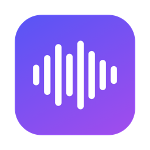

<p align="center">
  
</p>

<h1 align="center">Lecture Notes</h1>

<p align="center">
  <b>Hit record in class. Get clean, structured notes when it's over.</b><br>
  A tiny macOS menu bar app that transcribes lectures on-device and turns them into study notes with AI.
</p>

<p align="center">
  
  
  
</p>

---

## How it works

```
 Record  →  live on-device transcript  →  Stop  →  AI notes  →  paste anywhere / Google Docs
```

1. Click the waveform icon in your menu bar and hit **Start recording**.
2. Watch the transcript appear live. It's transcribed **on your Mac** with Apple's `SpeechAnalyzer`, so audio never leaves your laptop.
3. Hit **Stop**. The transcript goes to an AI model, which writes clean notes: a one-line summary, sections, bullets, bold key terms, and a glossary.
4. Click **Copy notes** and paste into Google Docs, Notion, Apple Notes, or anywhere else. Formatting comes with it. Or connect Google Drive and every lecture becomes a Doc automatically.

## Features

- **Lives in the menu bar.** No Dock icon and no windows. Click, record, done.
- **Private, on-device transcription** with a live transcript as the lecture happens.
- **Key terms.** Type hints like `merge sort, divide and conquer` and the recognizer listens for them. The AI also uses them to fix words the recognizer mishears. They work retroactively too: re-transcribe old lectures with new terms.
- **Free by default.** Uses Google's free Gemini tier. You can also bring your own key for Claude, OpenAI, OpenRouter or DeepSeek, run it locally with Ollama, or point it at any OpenAI-compatible endpoint.
- **Resilient.** It retries when the AI is overloaded and falls back to other free Gemini models if one is retired. Recordings and transcripts are saved before the AI step, so nothing is lost. If something fails, hit **Retry**.
- **Your style.** The note-taking prompt is editable. The default is minimal: a statement, then bullets with ***bold and italic*** key ideas.
- **Mic only, or mic + system audio** for online lectures and Zoom.
- **History** of every lecture: copy, view, re-generate, or re-transcribe.
- **Launch at login**, and a quit warning so you can't accidentally kill a recording.

## Install

Requires **macOS 26** or later.

```bash
git clone https://github.com/NathanYJiang/lecture-notes.git
cd lecture-notes
./build.sh --install     # builds, copies to /Applications, and launches
```

Then:

1. Look for the waveform icon at the top right of your screen.
2. Get a free Gemini key at [aistudio.google.com/apikey](https://aistudio.google.com/apikey).
3. Paste it into **Settings → AI**.
4. Allow the mic when macOS asks on your first recording.

<details>
<summary><b>Tip: stop macOS re-asking for permissions after every rebuild</b></summary>

Run `scripts/make-dev-cert.sh` once. It creates a local self-signed code-signing identity, and `build.sh` uses it automatically. Without it, builds are ad-hoc signed, so macOS treats every build as a new app.
</details>

## AI providers

| Provider | Cost | Notes |
|---|---|---|
| **Gemini** (default) | Free | Uses `gemini-flash-latest`. Free-tier prompts may be used by Google for training |
| Claude | ~$0.10 per hour of lecture | Default `claude-opus-5-5`. `claude-haiku-5-5` costs a fraction of a cent |
| OpenRouter | Free models available | Look for the `:free` suffix |
| OpenAI / DeepSeek | Cheap | Bring your own key |
| Ollama | Free, fully local | `ollama pull qwen3:8b`. Raise `OLLAMA_CONTEXT_LENGTH` so a full lecture fits |
| Custom | – | Any OpenAI-compatible `/chat/completions` endpoint |

## Google Docs (optional)

Without sign-in, the app works in **copy & paste** mode. To have each lecture saved as a Google Doc in a Drive folder you choose, set up a Google OAuth client once:

<details>
<summary><b>One-time Google Cloud setup (~5 min)</b></summary>

1. Create a project at [console.cloud.google.com](https://console.cloud.google.com).
2. **APIs & Services → Library**: enable the **Google Drive API**.
3. **Google Auth Platform → Branding**: set the app name and support email. **Audience**: External, and add yourself as a test user.
4. **Data Access**: add the scope `https://www.googleapis.com/auth/drive.file`.
5. **Clients → Create client**: type **iOS**, bundle ID `com.nathanjiang.LectureNotes`. Copy the client ID.
6. Run `echo "<client id>" > google-client-id.txt`, then `./build.sh --install`. The file is gitignored.

The app only asks for `drive.file`, so it can only see files and folders it created itself. Apps left in "Testing" mode need you to sign in again every 7 days.
</details>

## Privacy

- Audio and transcription stay on your Mac.
- Only the transcript text, and any key terms you typed, is sent to the AI provider you choose.
- API keys are stored in the macOS Keychain.
- Everything is saved locally under `~/Library/Application Support/LectureNotes/Recordings/`.

## Development

```bash
./build.sh                 # build/LectureNotes.app
./package.sh               # build/LectureNotes-<version>.dmg installer
swift build && .build/debug/LectureNotes --snapshot /tmp/shots   # render every pane to PNG
scripts/reset-new-user.sh  # reset this Mac to a first-run state (moves recordings to the Desktop)
```

<details>
<summary><b>Project layout</b></summary>

| File | What it does |
|---|---|
| `LectureNotesApp.swift` | Menu bar scene, first-launch welcome, safe quit |
| `AppState.swift` | Record → transcribe → summarize → save state machine, history |
| `Recorder.swift` | Mic (AVAudioEngine) and system audio (ScreenCaptureKit) capture |
| `LiveTranscriber.swift` / `Transcriber.swift` | On-device `SpeechAnalyzer`, live and from file |
| `Summarizer.swift` | LLM calls with retry, backoff, and Gemini model fallback |
| `Markdown.swift` | Notes → HTML for rich paste and Google Docs |
| `Google.swift` | OAuth (PKCE) and Drive upload |
| `PopoverView.swift` / `SettingsView.swift` / `DesignSystem.swift` | UI |
</details>

<details>
<summary><b>Signing & notarizing a release</b></summary>

With an Apple Developer ID ($99/yr), the DMG opens on any Mac with no Gatekeeper warning:

```bash
xcrun notarytool store-credentials notary --apple-id you@example.com --team-id TEAMID
SIGN_ID="Developer ID Application: Your Name (TEAMID)" NOTARY_PROFILE=notary ./package.sh
```
</details>
